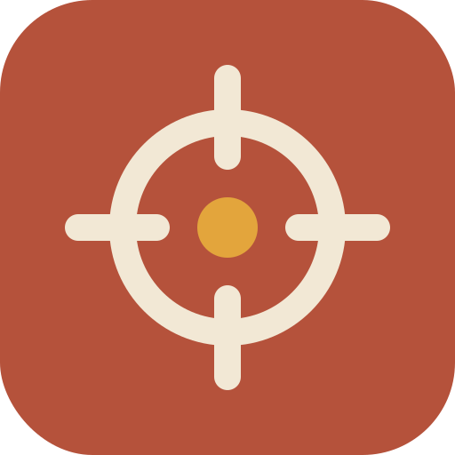
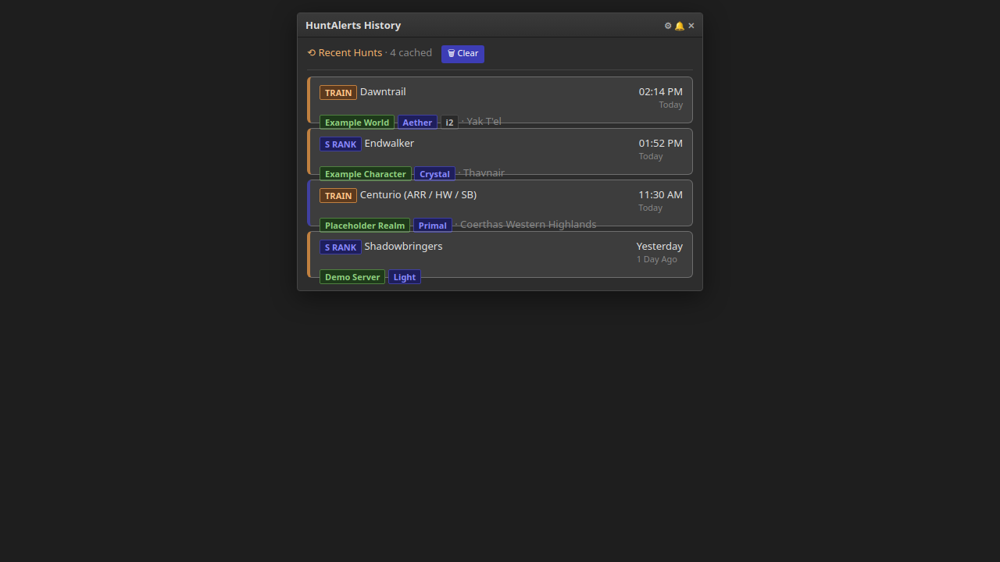
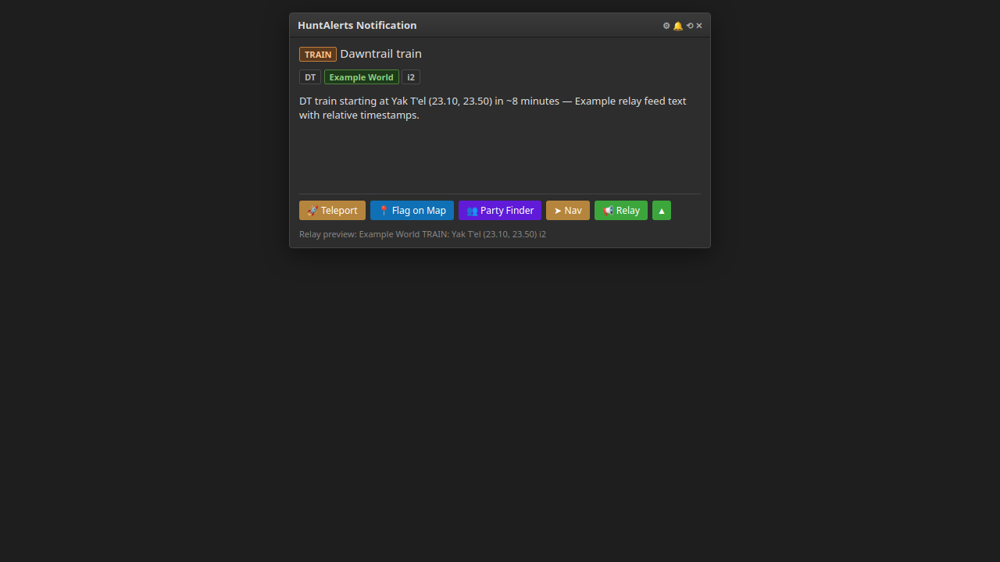
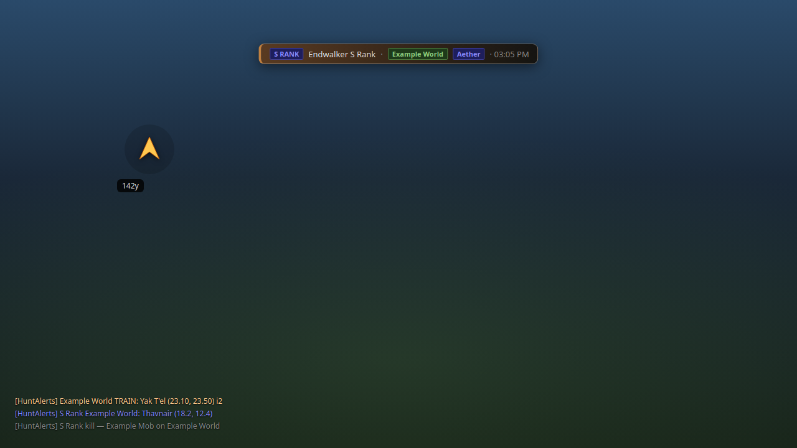
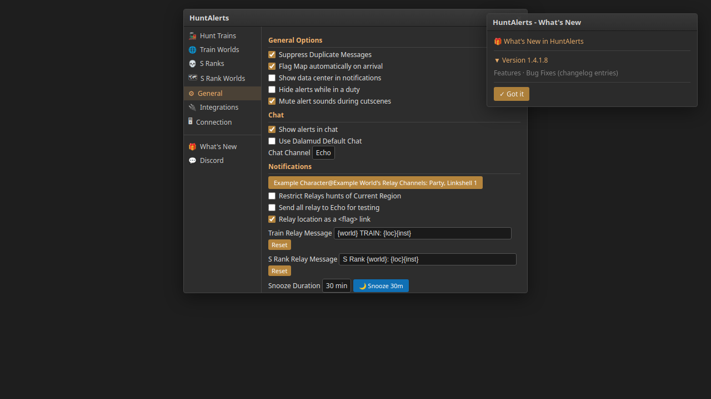
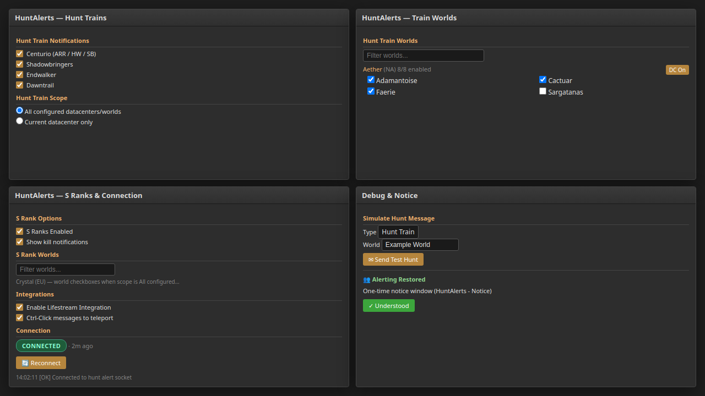
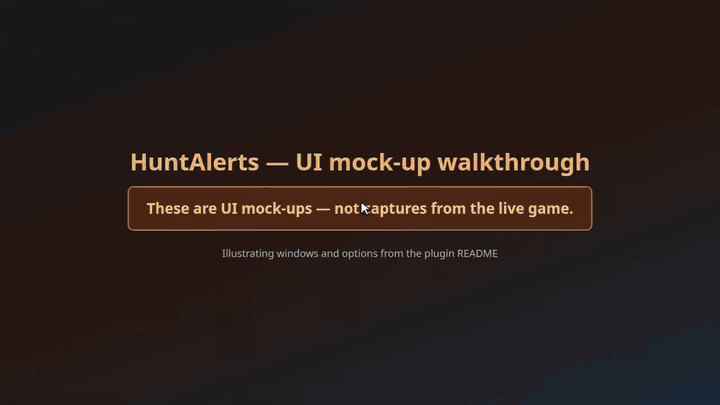

# HuntAlerts — private build



> ## ⚠️ Do not use this repository
> **This is a private-use fork. It is published only so I can install it on my own machines — do not use it, do not add it
> as a plugin repository, and do not report issues with it.**
>
> The upstream plugin is maintained by Asuna. Use that instead:
> `https://puni.sh/api/repository/asuna` — support lives in the `asuna-plugins` channel of the Puni.sh Discord
> (https://discord.gg/punishxiv).

Fork of HuntAlerts 1.4.1.10 (upstream: https://projects.gamba.pro/Asuna/huntalerts), plus the changes listed under
[Changes in this fork](#changes-in-this-fork). The only functional addition is **customisable relay messages**.
Author of this build: PriestKos — the plugin and the idea are Asuna's, this is only a private carry-over of it.

`/huntalerts` · Dalamud API 15 · .NET 10

## What it does

Notifies you when hunt trains are starting soon and when S ranks are found, on NA/EU/OCE/JP worlds, from the same alert
feed the upstream plugin uses. Alerts arrive as in-game chat lines, as a notification window, and optionally as an
on-screen toast; trains and S ranks can be relayed into a chat channel with one button.

## Screenshots

Screenshots are mock-ups illustrating the UI, not captures from the live game.

| | |
|---|---|
|  | **Recent Hunts** (`/huntalerts`, Dalamud *Open Dalamud UI*): cached alert cards, **Clear**, title-bar settings/snooze. |
|  | **Notification window**: train/S rank details, **Teleport**, **Flag on Map**, **Party Finder**, **Nav**, **Relay** (+ channel picker), relay preview on hover. |
|  | **Toast banner**, **navigation arrow** (distance label), and **chat alerts** (including S rank kill line when enabled). |
|  | **Settings** (`/huntalerts settings`): **General**, chat/relay templates, snooze, sounds, toast & arrow options; **What's New** window. |
|  | **Hunt Trains** / **Train Worlds**, **S Ranks** / **S Rank Worlds**, **Integrations**, **Connection**, **Debug** simulate, **Alerting Restored** notice. |

### Feature coverage (UI)

| Feature | Screenshot |
|---|---|
| `/huntalerts` → HuntAlerts History | 01 |
| `/huntalerts settings` / `s` → HuntAlerts config | 04, 05 |
| `/huntalerts debug` / `d` → Debug tab | 05 |
| Notification popup (HuntAlerts Notification) | 02 |
| Recent hunt card → opens notification | 01 → 02 |
| Snooze / wake (history title bar & General tab) | 01, 04 |
| Relay + one-off channel picker + `<flag>` templates | 02, 04 |
| Teleport / Flag on Map / Party Finder / Nav | 02 |
| Chat alerts & text colours | 03, 04 |
| Toast banner (duration, animation, position) | 03, 04 |
| Navigation arrow & chat flag pickup (Shout/Yell/Party) | 03, 04 |
| Hunt train groups, scope, Train Worlds | 05 |
| S ranks, kill notifications, scope, S Rank Worlds | 05 |
| Lifestream integration & Ctrl-click teleport | 05 |
| Socket connection status, reconnect, activity log | 05 |
| Debug: Simulate Hunt Message | 05 |
| What's New changelog | 04 |
| Alerting Restored notice (HuntAlerts - Notice) | 05 |
| Sidebar: Discord link | 04 |

Every user-facing window and slash command in the plugin is shown above. Non-UI behaviour (socket parsing, IPC, config file path) is described in text elsewhere in this README.

### Mock-up video

The clip below is a **mock-up walkthrough** of the same HTML UI sources — **not** captures from the live game. It opens with an on-screen disclaimer and tours each mock-up with short captions, eased scene transitions, and scripted pointer interactions (sidebar tabs, toggles, relay picker).



[Download full walkthrough (MP4)](docs/videos/mockup-walkthrough.mp4)

## Changes in this fork

**Customisable relay messages** (the only functional change):

- Two message templates, one for hunt trains and one for S ranks, under *Notifications* in the settings window.
- Tokens are substituted literally — anything else in the template is sent as written:

  | Token | Replaced with |
  |---|---|
  | `{world}` | Hunt world, e.g. `Sargatanas` |
  | `{zone}` | Starting zone, e.g. `Yak T'el` |
  | `{coords}` | Plain coordinates `(23.10, 23.50)`, empty when the feed has none |
  | `{loc}` | `<flag>` when *Relay location as a `<flag>` link* is on and the flag could be set, otherwise zone + coordinates |
  | `{inst}` | ` i2` for an instance above 1 (empty otherwise) |
  | `{type}` | `TRAIN` or `S Rank` |

- Defaults reproduce the previous output exactly:
  - Train: `{world} TRAIN: {loc}{inst}` → `Sargatanas TRAIN: Yak T'el (23.10, 23.50) i2`
  - S Rank: `S Rank {world}: {loc}{inst}` → `S Rank Sargatanas: <flag>`
- An empty template falls back to the default, and each field has a **Reset** button.
- Hovering the **Relay** button on a notification now previews the exact line that will be sent.
- The 500-character chat line cap and the `/echo` test mode are unchanged.

Other differences: version bumped to 1.4.1.11, README rewritten.

## How it works

The plugin connects to the hunt alert socket upstream uses, filters alerts by your enabled groups, datacenters and worlds
(and separately for trains and S ranks), and shows them through a notification window, chat lines and an optional toast.
A navigation arrow points at a hunt while you are in its zone. Relaying sends a `/say`, `/party`, `/linkshell n`,
`/cwls n`, … command through the game's chat box, holding `<flag>` when the flag link is enabled.

## Commands

| Command | Action |
|---|---|
| `/huntalerts` | Open the list of previous alerts |
| `/huntalerts settings` (or `s`) | Open the settings window |
| `/huntalerts debug` (or `d`) | Open the settings window on its debug page |

## Settings

Per character: relay channels (linkshells and CWLS are also tracked per region), region lock, and player identity.
Global: alert scope and world/datacenter/group filters for trains and S ranks, chat alert on/off with output channel and
text colours, notification options (datacenter name, open map on arrival, Lifestream integration, ctrl-click teleport),
toast position/duration/animation, sounds (built-in or custom file for trains and S ranks), snooze duration, echo test
mode, `<flag>` link relaying, and the two relay message templates.

Config file: `%APPDATA%\XIVLauncher\pluginConfigs\HuntAlerts.json`.

## Build

Requires the .NET 10 SDK and a Dalamud dev distrib at `%APPDATA%\XIVLauncher\addon\Hooks\dev` (or `DALAMUD_HOME`).
ECommons is a submodule:

```sh
git clone --recurse-submodules <this repo>
dotnet build HuntAlerts/HuntAlerts.csproj -c Release
```

Output: `HuntAlerts/bin/Release/HuntAlerts.dll` and the generated `HuntAlerts.json` manifest next to it.

Releases are published automatically on each push to `main` that changes the plugin (not docs-only paths); the version is the next four-part number above the latest GitHub release.

## Install (dev plugin)

1. Copy `HuntAlerts.dll` **and** `HuntAlerts.json` into `%APPDATA%\XIVLauncher\devPlugins\HuntAlerts\`.
2. `/xlsettings` → Experimental → Dev Plugin Locations: add that folder.
3. `/xlplugins` → Dev Tools → enable **Hunt Alerts**.

## Limits

- Not reviewed or supported upstream; behaviour is taken from the code and off-game tests of the template logic, not from
  a live client run of this fork.
- Templates are plain text: no markup, no conditional sections. Coordinates come from the alert feed, so a message can be
  as short as `S Rank Sargatanas: <flag>`.
- The relay line is truncated to 500 characters, template included.

## Licence

AGPL-3.0-or-later, as upstream. Original plugin © Asuna; this fork's changes are released under the same licence.
